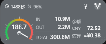

# Work Dashboard for DeepSeek Harness

一个浮在 DeepSeek Harness Web GUI 之上的客户端仪表盘（HUD）：实时显示会话工作状态、账户余额、token 用量与按模型估算的费用。

<p align="center">
  
</p>

- 速度表（tokens/s，带主/辅刻度）
- IN / OUT / TOTAL 与缓存命中率
- DeepSeek 平台账户余额（读不到时显示 `-`）
- 其他模型的费用估算（按 token 增量 × 单价）
- 点击熊猫头像向左下展开面板；拖动标题栏移动；右下角手柄缩放；位置与尺寸自动持久化
- 深色/浅色界面随主题自适应，支持中英文

## 安装

1. 将本仓库放到任意目录，例如 `~/dsh-plugins/work-dashboard`。
2. 在 dsh profile 的 `package.json`（例如 `~/.dsh/profiles/desktop/package.json`）中注册为本地依赖：

   ```json
   {
     "dependencies": {
       "@local/work-dashboard": "link:~/dsh-plugins/work-dashboard"
     }
   }
   ```

3. 把插件加入该 profile 的 bundle 列表：

   ```json
   {
     "dsh": {
       "profile": {
         "bundles": [
           "@deepseek-ai/dsh-base",
           "@deepseek-ai/dsh-web-app",
           "@local/work-dashboard"
         ]
       }
     }
   }
   ```

4. 重启 dsh（profile 配置了 `patchReload: live` 时保存即生效）。

插件通过 `dsh.bundle.patch` 注入客户端条目，客户端模块需要 `remote.session` 与 `remote.account` 两个命名空间；两者都会在模块 `inject` 中声明，缺失时仪表盘降级显示而不是拖垮启动。

## 使用

| 操作 | 效果 |
| --- | --- |
| 点击头像 | 向左下展开 / 收起面板 |
| 拖动标题栏 | 移动整个 HUD |
| 拖动右下角手柄 | 调整面板尺寸 |
| 点击 `¥` | 打开单价编辑弹窗（每百万 token） |

### 余额与费用估算

- **DeepSeek**（`deepseek-account`）：直接显示平台账户的真实余额，不参与费用估算，避免与余额重复计算。
- **其他模型**：按“插件启动以来”的 token 增量估算本轮费用，显示为 `≈¥x.xx`；单价未填时显示 `-`。
- **Ollama** 等本地模型：不产生费用，完全排除在估算与单价弹窗之外。
- 未填单价的模型会在费用提示中按模型去重计数。

### 内置单价

`¥` 弹窗会预填以下官方刊例价（人民币 / 百万 token，实时档），可随时覆盖：

| 模型 | 输入（缓存未命中） | 输出 | 缓存读 |
| --- | --- | --- | --- |
| `xiaomi/mimo-v2.6-flash` | 1 | 2 | 0.02 |
| `xiaomi/mimo-v2.6-pro` | 3 | 6 | 0.025 |
| `xiaomi/mimo-v2.6-pro-ultraspeed` | 30 | 60 | 0.25 |

价格来源：[Xiaomi MiMo 按量计费](https://mimo.mi.com/docs/zh-CN/price/pay-as-you-go)（2026-11）。缓存写按缓存未命中输入价计。单价保存在本地 `localStorage`，不会上传。

> 估算只覆盖插件启动后的增量；重启 dsh / 重载插件后基线归零。DeepSeek 输入存在空闲/高峰两档价格，余额由官方账户直接给出，因此无需在插件内区分时段。

## 开发

无需安装依赖，Node.js 18+ 即可运行冒烟测试（内置 ModuleLoader 与 React stub，覆盖数据管线、刷新容错、余额、费用与渲染输出）：

```bash
npm test
```

目录结构：

```
client.js          # 客户端插件主体（UI、数据管线、诊断）
index.js           # bundle 入口
cordis.patch.yml   # 向 profile 注入插件条目
locale/            # en / zh 文案
icon.svg           # 头像图标
test/smoke.test.mjs
```

运行时诊断写入 `localStorage['dsh.work-dashboard.diag']`，包含构建版本、刷新次数、余额状态与费用统计，便于在 Electron 外部排查。

## License

MIT，见 [LICENSE](./LICENSE)。
